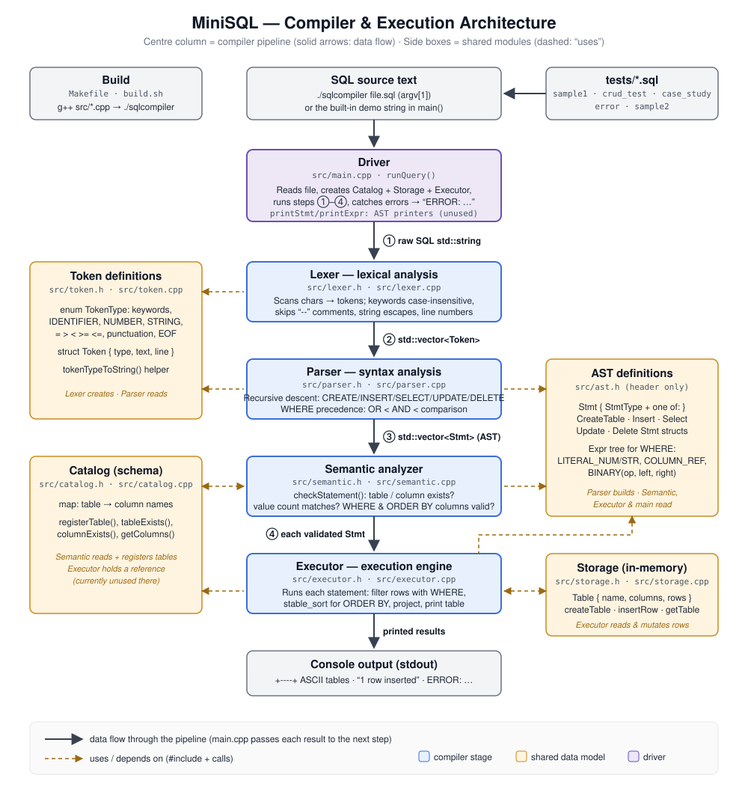

# MiniSQL — Compiler & Execution Engine

A lightweight, modular **SQL Compiler, Query Parser, Semantic Analyzer, and In-Memory Execution Engine** written in **C++17** supporting full **CRUD (Create, Read, Update, Delete)** operations.

MiniSQL parses, semantically validates, and executes core SQL statements (`CREATE TABLE`, `INSERT INTO`, `SELECT`, `UPDATE`, and `DELETE FROM` with compound `WHERE` logic and `ORDER BY` sorting), producing clean, aligned ASCII tabular output.

---

## 🌟 Key Features

* **Lexical Analyzer (Lexer)**: Tokenizes SQL keywords (`SELECT`, `FROM`, `WHERE`, `ORDER`, `BY`, `CREATE`, `TABLE`, `INSERT`, `INTO`, `VALUES`, `UPDATE`, `SET`, `DELETE`, `AND`, `OR`), identifiers, numbers, quoted strings, comparison operators, and skips `--` single-line comments.
* **Recursive-Descent Parser**: Builds Abstract Syntax Trees (AST) for SQL queries while maintaining operator precedence (`AND` / `OR` in `WHERE` clauses).
* **Schema Catalog & Semantic Analyzer**: Validates table and column definitions, prevents duplicate table creation, checks target columns in `UPDATE`, and ensures column/value count matching before execution.
* **In-Memory Storage Engine**: Manages dynamic schemas and table row collections in memory with fast record lookup, updates, and removals.
* **Execution Engine**: Evaluates binary logic and comparisons (`=`, `!=`, `<`, `>`, `<=`, `>=`), filters rows, sorts results by target columns, updates target fields, deletes matching records, and formats output as aligned ASCII tables.
* **Verbose Compiler Trace**: `--verbose` prints every phase — the token stream, the AST drawn as a tree (`├──` / `└──`), and each semantic check — before the results.
* **Multi-Statement / Script Execution**: Processes full multi-query `.sql` files sequentially with persistent in-memory state across statements.

---

## 🏗️ Architecture Pipeline



---

## 📄 Source Files

| File | What it does |
|---|---|
| [`main.cpp`](src/main.cpp) | Entry point: reads the `.sql` file and runs it through the lexer, parser, semantic analyzer, and executor; with `--verbose`, prints the tokens and the AST as a tree. |
| [`token.cpp`](src/token.cpp) | Converts each `TokenType` into its readable name (e.g. `IDENTIFIER`) for debug output. |
| [`lexer.cpp`](src/lexer.cpp) | Breaks raw SQL text into tokens (keywords, identifiers, numbers, strings, operators), skipping whitespace and `--` comments. |
| [`parser.cpp`](src/parser.cpp) | Recursive-descent parser that turns the tokens into an AST, with `OR` < `AND` < comparison precedence in `WHERE`. |
| [`catalog.cpp`](src/catalog.cpp) | Schema catalog that records each table's column names so they can be checked before execution. |
| [`semantic.cpp`](src/semantic.cpp) | Validates each statement against the catalog: tables and columns exist, and value counts match. |
| [`storage.cpp`](src/storage.cpp) | In-memory storage engine that holds every table's rows and creates, inserts, and looks up tables. |
| [`executor.cpp`](src/executor.cpp) | Runs each statement: evaluates `WHERE`, sorts with `ORDER BY`, updates or deletes rows, and prints `SELECT` results as ASCII tables. |

---

## 💻 Supported SQL Subset (CRUD)

Keywords are case-insensitive (`SELECT` = `select`), every statement ends with `;`, and `--` starts a single-line comment.

### 1. Create Table (Create)
```sql
-- Column names only
CREATE TABLE employees (id, name, department, salary);

-- Optional column types are also accepted, including sizes
CREATE TABLE employees (id INT, name VARCHAR(50), department VARCHAR(30), salary DECIMAL(10, 2));
```
> Column types are parsed but not enforced: every value is stored as text and compared as a number when it looks like one.

### 2. Insert Data (Create)
```sql
INSERT INTO employees VALUES (1, 'Alice', 'Engineering', 75000);
INSERT INTO employees VALUES (2, 'Bob', 'Marketing', 50000);
INSERT INTO employees VALUES (3, 'O\'Neil', 'Sales', 55000.50);   -- \' escapes a quote
```
A value must be given for every column, in table order.

### 3. Query & Filter Data (Read)
```sql
-- Select all columns
SELECT * FROM employees;

-- Projected columns with compound WHERE condition and ORDER BY sorting
SELECT name, department, salary FROM employees WHERE salary >= 60000 AND department = 'Engineering' ORDER BY salary;

-- Not-equal (!= or <>) combined with OR
SELECT name FROM employees WHERE department != 'Sales' OR salary < 52000 ORDER BY name;
SELECT name FROM employees WHERE department <> 'Engineering';
```

### 4. Update Data (Update)
```sql
-- Update with WHERE filter
UPDATE employees SET salary = 80000 WHERE name = 'Alice';

-- Bulk update
UPDATE employees SET department = 'Sales';
```

### 5. Delete Data (Delete)
```sql
-- Delete matching records
DELETE FROM employees WHERE department = 'Marketing' AND salary <= 50000;

-- Delete all records in table
DELETE FROM employees;
```

### `WHERE` Clause Reference

| Feature | Supported |
|---|---|
| Comparison operators | `=`, `!=`, `<>`, `<`, `>`, `<=`, `>=` |
| Logical operators | `AND`, `OR` (`AND` binds tighter than `OR`) |
| Operands | column names, numbers (`42`, `3.5`), strings (`'Alice'`) |
| Comparison rules | numeric if both sides are numbers, otherwise alphabetical |

### Not Supported (yet)

* Parentheses in `WHERE`, e.g. `WHERE (a = 1 OR b = 2) AND c = 3`
* Updating more than one column per `UPDATE` (`SET a = 1, b = 2`)
* `ORDER BY ... DESC` (sorting is ascending only), `LIMIT`, aggregates (`COUNT`, `SUM`, ...)
* Column lists in `INSERT` (`INSERT INTO t (a, b) VALUES ...`) and negative numbers
* `JOIN`, `DROP TABLE`, `NULL`, and saving data between runs (each run starts with an empty database)

---

## 🚀 Quick Start

### Prerequisites
* A C++17 compatible compiler (e.g., `g++` 7.0 or higher). Check with `g++ --version`; if it's missing:
  * **macOS**: `xcode-select --install`
  * **Ubuntu / Debian**: `sudo apt install build-essential`
  * **Windows**: use WSL, then the Ubuntu command above
* `make` or `bash` (optional)

### 1. Clone the Repository

```bash
git clone https://github.com/milpatel15/minisql.git
cd minisql
```

### 2. Compile the Project

* **Using `Makefile`** (recommended):
  ```bash
  make
  ```

* **Using `build.sh`**:
  ```bash
  chmod +x build.sh
  ./build.sh
  ```

* **Using `g++` directly**:
  ```bash
  g++ -Wall -std=c++17 src/*.cpp -o sqlcompiler
  ```

This produces the `./sqlcompiler` executable in the project folder. Re-run `make` after editing any file in `src/`.

### 3. Run SQL Scripts

Execute a multi-statement SQL script file:

```bash
./sqlcompiler tests/crud_test.sql
```

Or run the multi-table university tracking case study:

```bash
./sqlcompiler tests/case_study.sql
```

Or run your own `.sql` file:

```bash
./sqlcompiler path/to/your_queries.sql
```

Or run without arguments to execute built-in fallback queries:

```bash
./sqlcompiler
```

Each run starts with an empty in-memory database, so every script should begin with `CREATE TABLE`.

### 4. View Every Compiler Phase (Verbose Mode)

Add `--verbose` (or `-v`) to print the token stream (lexical analysis), the AST as a tree (syntax analysis), and each semantic check before the results:

```bash
./sqlcompiler --verbose tests/sample1.sql
```

The AST is printed with `Program` as the root and one branch per statement. In a `WHERE` tree, the operator closest to the root is evaluated last — e.g. `AND` sits above `>=` and `>` because it binds more loosely.

### 5. Reading the Output

| Output | Meaning |
|---|---|
| `Table 'x' created successfully.` / `1 row inserted into 'x'.` | Statement succeeded |
| `N rows updated in 'x'.` / `N rows deleted from 'x'.` | Statement succeeded |
| ASCII table followed by `(N rows)` | `SELECT` succeeded; the table is the query result |
| `ERROR: Parse error at line N: ...` | Syntax error: nothing in the file is executed |
| `ERROR: Unknown table/column ...` | Semantic error: earlier statements ran, this one and the rest are skipped |

A script passed if every statement printed its success message and no `ERROR:` line appears. (`tests/error.sql` is *expected* to fail.)

> **Troubleshooting:** `zsh: no such file or directory: ./sqlcompiler` means the program hasn't been built yet (run `make`) or you're not in the `minisql` folder. `Could not open file: ...` means the `.sql` path is wrong.

---

## 📊 Sample Execution Output

### Normal Mode

Running `./sqlcompiler tests/crud_test.sql`:

```text
Table 'employees' created successfully.
1 row inserted into 'employees'.
1 row inserted into 'employees'.
1 row inserted into 'employees'.
1 row inserted into 'employees'.
1 row inserted into 'employees'.
+----+---------+-------------+--------+
| id | name    | department  | salary |
+----+---------+-------------+--------+
| 1  | Alice   | Engineering | 75000  |
| 2  | Bob     | Marketing   | 50000  |
| 3  | Charlie | Engineering | 68000  |
| 4  | David   | Sales       | 55000  |
| 5  | Eve     | Marketing   | 52000  |
+----+---------+-------------+--------+
(5 rows)

1 row updated in 'employees'.
1 row updated in 'employees'.
+----+---------+-------------+--------+
| id | name    | department  | salary |
+----+---------+-------------+--------+
| 1  | Alice   | Engineering | 75000  |
| 2  | Bob     | Sales       | 50000  |
| 3  | Charlie | Engineering | 72000  |
| 4  | David   | Sales       | 55000  |
| 5  | Eve     | Marketing   | 52000  |
+----+---------+-------------+--------+
(5 rows)

1 row deleted from 'employees'.
1 row deleted from 'employees'.
+---------+-------------+--------+
| name    | department  | salary |
+---------+-------------+--------+
| Eve     | Marketing   | 52000  |
| David   | Sales       | 55000  |
| Charlie | Engineering | 72000  |
+---------+-------------+--------+
(3 rows)
```

### Verbose Mode

Running `./sqlcompiler --verbose tests/sample2.sql` (note the `VARCHAR` column type is accepted):

```text
========== PHASE 1: LEXICAL ANALYSIS (tokens) ==========
LINE  TYPE          TEXT
1     CREATE        CREATE
1     TABLE         TABLE
1     IDENTIFIER    EMPLOYEE
1     LPAREN        (
1     IDENTIFIER    id
1     COMMA         ,
1     IDENTIFIER    NAME
1     IDENTIFIER    VARCHAR
1     RPAREN        )
1     SEMICOLON     ;
2     INSERT        INSERT
2     INTO          INTO
2     IDENTIFIER    EMPLOYEE
2     VALUES        VALUES
2     LPAREN        (
2     NUMBER        1
2     COMMA         ,
2     STRING        MILAN
2     RPAREN        )
2     SEMICOLON     ;
2     END_OF_FILE
(21 tokens)

========== PHASE 2: SYNTAX ANALYSIS (AST) ==========
2 statement(s) parsed successfully.

Program
├── CreateTableStmt
│   ├── Table: EMPLOYEE
│   └── Columns
│       ├── id
│       └── NAME
└── InsertStmt
    ├── Table: EMPLOYEE
    └── Values
        ├── 1
        └── MILAN

========== PHASE 3 & 4: SEMANTIC ANALYSIS + EXECUTION ==========
[Statement 1] semantic check: OK
Table 'EMPLOYEE' created successfully.
[Statement 2] semantic check: OK
1 row inserted into 'EMPLOYEE'.
```

### AST Tree for a `WHERE` Query

Phase 2 of `./sqlcompiler --verbose tests/sample1.sql`, showing the last statement — `SELECT name, age FROM students WHERE age < 20 OR age > 23 ORDER BY age;`:

```text
Program
├── ...  (CreateTable, 5 × Insert, 2 earlier Selects)
└── SelectStmt
    ├── Columns
    │   ├── name
    │   └── age
    ├── From: students
    ├── Where
    │   └── BinaryExpr (OR)
    │       ├── BinaryExpr (<)
    │       │   ├── ColumnRef: age
    │       │   └── LiteralNum: 20
    │       └── BinaryExpr (>)
    │           ├── ColumnRef: age
    │           └── LiteralNum: 23
    └── OrderBy: age
```

### Error Example

Running `./sqlcompiler tests/error.sql`:

```text
Table 'students' created successfully.
ERROR: Unknown column 'badcol' in table 'students'
```

---

## 📁 Repository Structure

```text
minisql/
├── src/
│   ├── ast.h           # AST node definitions (Create, Insert, Select, Update, Delete)
│   ├── catalog.h/cpp   # Schema catalog tracking
│   ├── executor.h/cpp  # Query execution engine & ASCII renderer
│   ├── lexer.h/cpp     # Lexical analysis & tokenization
│   ├── main.cpp        # CLI entry point
│   ├── parser.h/cpp    # Recursive-descent parser
│   ├── semantic.h/cpp  # Semantic validation checks
│   ├── storage.h/cpp   # In-memory table & row storage
│   └── token.h/cpp     # Token type definitions
├── tests/
│   ├── crud_test.sql   # Full CRUD lifecycle test script
│   ├── case_study.sql  # Multi-table university tracking test case
│   ├── sample1.sql     # Analytical queries test script
│   ├── sample2.sql     # Schema test script
│   └── error.sql       # Error handling validation script
├── docs/
│   ├── architecture.svg # Architecture flow diagram
│   └── progress.md     # Task progress & milestone log
├── Makefile            # Build automation configuration
├── build.sh            # Shell compilation script
└── README.md           # Project documentation
```

---

## 📝 License

This project is open-source under the [MIT License](LICENSE).